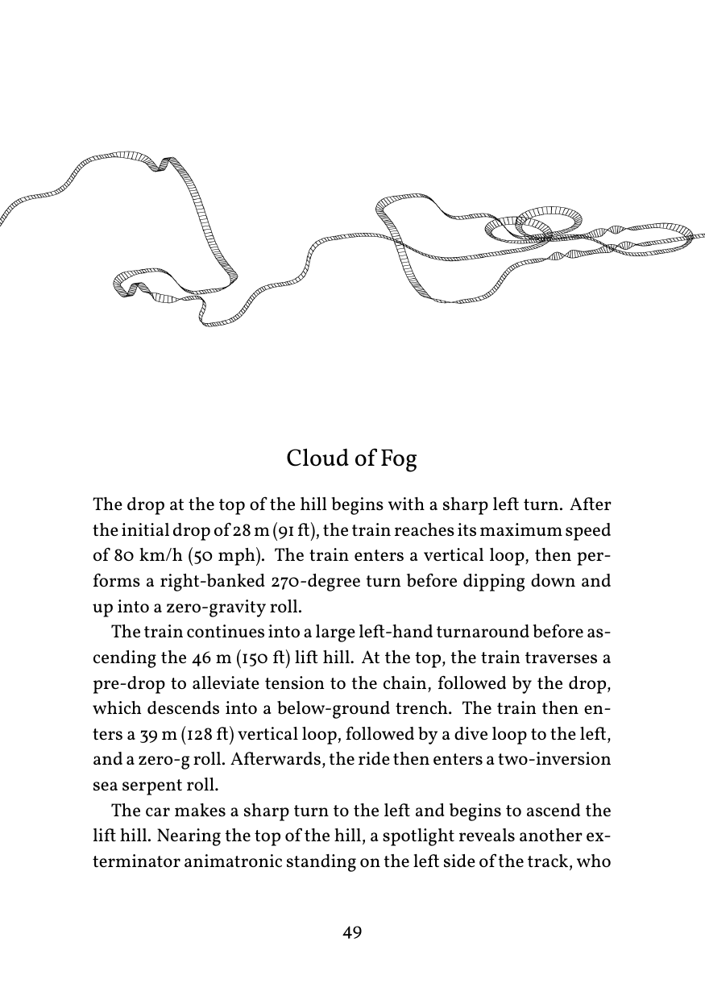

# SCREAM!

A very long roller coaster. Created for [NaNoGenMo 2026](https://github.com/NaNoGenMo/2026).

I was reading the Wikipedia article for [Eejanaika](https://en.wikipedia.org/wiki/Eejanaika_(roller_coaster)), the best roller coaster I’ve been on, and enjoyed how such an exhilarating experience had been described in matter-of-fact, jargon-dense prose. Turns out all coaster articles have such narratives! This program stitches them together into one continuous ride. For added pizzazz, it includes illustrations based on a model of the über-coaster.

To generate a novel:

```sh
python3 -m venv .venv
source .venv/bin/activate
pip install -r requirements.txt
python scream.py
```

[Example output](https://github.com/nmifsud/scream/blob/main/scream-261106-231036.pdf ) (50,050 words)

